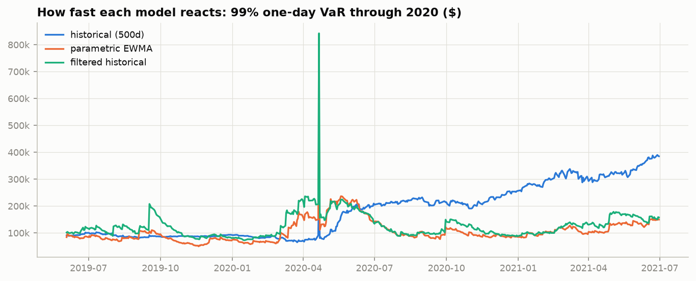
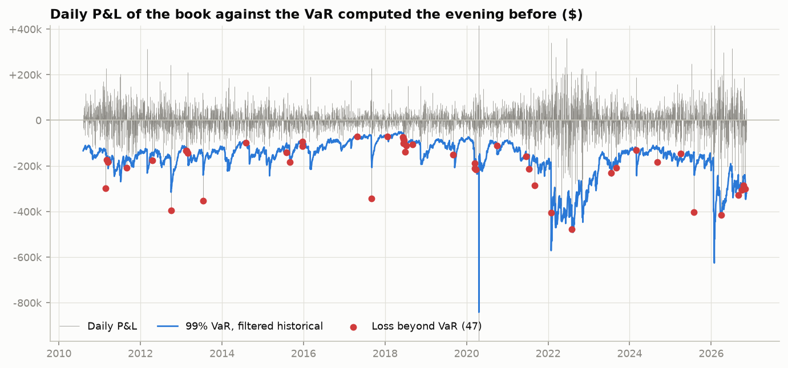
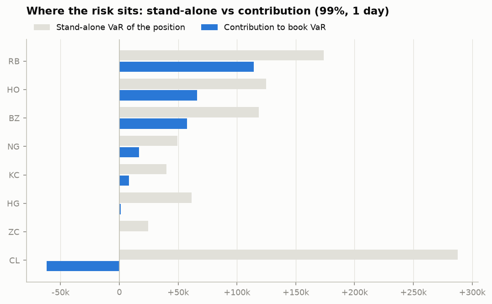
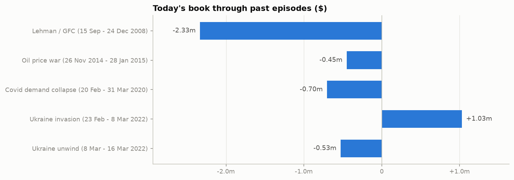

# commodity-book-var

A small risk engine for a book of commodity futures. You give it positions in lots, it gives you one-day VaR and expected shortfall three different ways, tells you which positions carry the risk and which ones hedge, backtests all of it over 16 years, and runs the book through 2008, 2014, 2020 and 2022.

The point for me was the backtest. Computing a VaR number is ten lines. Knowing whether to believe it is the actual work.

```bash
pip install -r requirements.txt
python run.py              # uses book.json
python run.py mybook.json  # your own positions
pytest
```

## The example book

`book.json` holds a book that looks roughly like something a trading desk might run, not eight random longs:

| | lots | exposure |
|---|---|---|
| WTI crude | −45 | −$4.0m |
| RBOB gasoline | +20 | +$2.2m |
| ULSD | +10 | +$1.8m |
| Brent crude | +15 | +$1.4m |
| Henry Hub gas | −20 | −$0.6m |
| Copper | +12 | +$1.8m |
| Corn | +40 | +$0.9m |
| Arabica coffee | +8 | +$0.8m |

That's a long refining margin (short crude against long products, 3-2-1), a long Brent / short WTI spread, and a few outrights. Gross $13.6m, net $4.3m.

Lots become dollars through `dollar_per_point`, the P&L of one contract when the quote moves by 1.0. Sounds trivial, but corn is 5,000 bushels quoted in cents (so $50), coffee 37,500 lb in cents ($375), products 42,000 gallons in dollars ($42,000). Unit-tested.

## Three models, one book

| 99%, one day | VaR | expected shortfall |
|---|---|---|
| Historical simulation (500 days) | $256k | $327k |
| Parametric, EWMA covariance | $203k | $232k |
| Filtered historical simulation | $308k | $353k |

- **Historical**: replay the last 500 days on today's exposures. No distribution assumed, but slow: a calm two years means a low number no matter what happened yesterday.
- **Parametric**: normal distribution, RiskMetrics covariance (λ = 0.94). Reacts fast, but commodity returns aren't normal.
- **Filtered historical**: divide each past return by the volatility at the time, multiply by today's. Keeps the fat tails and reacts to the current regime.



## Which one should you believe

Every day from 2010: compute VaR with data up to yesterday, compare with what the book made today. A 99% VaR should be breached on 1% of days.

| model | breaches | expected | rate | Kupiec p | worst loss / VaR |
|---|---|---|---|---|---|
| Historical (500d) | 55 | 41 | 1.34% | 0.04 | 9.5x |
| Parametric EWMA | 88 | 41 | 2.15% | 0.00 | 4.7x |
| **Filtered historical** | **47** | **41** | **1.15%** | **0.35** | **2.9x** |



The normal model is breached more than twice as often as it should be. That's not a calibration problem, it's the distribution: commodity tails are fatter than a Gaussian, so the 99% quantile is too close in. Plain historical simulation gets the count roughly right over 16 years but bunches its misses (11 in 2015, 10 this year, and one loss 9.5 times the VaR) because it only notices a new regime once enough bad days have entered the window. The filtered version is the only one that passes the Kupiec test, and its worst miss is the smallest.

The per-year breakdown is in `results/latest.md`.

## Where the risk actually sits



Grey is each position's VaR on its own, blue is what it adds to the book (Euler allocation, the blue bars sum to the book VaR).

Stand-alone VaRs add up to $880k. The book is $203k. The short crude leg is the largest position by far and its contribution is *negative*: it's the hedge for the products and for Brent. If a risk manager asked "what's your biggest risk" and you answered "WTI, it's our largest position", that would be exactly wrong. The risk is the gasoline crack.

Copper and corn contribute almost nothing despite $2.7m of exposure between them, they're just uncorrelated with the energy core.

## Stress: what if the regime changes

VaR describes a bad day in the current regime. This replays the relative moves of past episodes on today's exposures.



| scenario | book P&L |
|---|---|
| Lehman / GFC, Sep-Dec 2008 | −$2.33m |
| Oil price war, Nov 2014 - Jan 2015 | −$0.45m |
| Covid demand collapse, Feb-Mar 2020 | −$0.70m |
| Ukraine invasion, 23 Feb - 8 Mar 2022 | +$1.03m |
| Ukraine unwind, 8-16 Mar 2022 | −$0.53m |

Being short crude makes $2.6m in 2008 and the book still loses $2.3m, because products, Brent and copper all fall and cracks collapse with demand. A long crack position is a long-demand position, the hedge only covers the flat-price part.

## The day the model couldn't have seen

The worst day in the backtest is 21 April 2020: −$2.46m against a VaR of $842k. The day before, the expiring May WTI contract had settled at −$37.63. The book is short crude, so that was a windfall. Then the front month rolled to June at +$10, a $47 move against the short on a contract that had been trading near $20.

Two things I took from handling this:

- Relative returns stop meaning anything near zero. "−306%" isn't a return. Those two days are excluded as *scenarios* (for all contracts, since removing only the WTI leg would leave the spreads half-hedged and invent losses), but the dollar P&L stays in the backtest, because it happened.
- No return-based model would have covered it. That's what position limits into expiry and stress tests are for.

## Limits

- Continuous front-month series. Real positions sit in specific contract months and roll, the roll gaps here are treated as P&L.
- Front-month only, so no curve risk. A calendar spread would show up as zero.
- Linear instruments only, no options.
- One-day horizon. The multi-day table in the report shows square-root-of-time is roughly fine at 5 days for this book and overstates at 10.
- Liquidity is ignored. 45 lots of WTI is nothing, but the same code would happily tell you a 5,000-lot coffee position can be exited at the close.

## Layout

```
bookvar/
  book.py       contract specs, book loader
  data.py       prices, scenario returns, dollar P&L
  var.py        the three models, component VaR
  backtest.py   rolling backtest, Kupiec and independence tests
  stress.py     episode replay, multi-day losses
  plots.py
book.json       example positions
run.py
```

Not investment advice.
